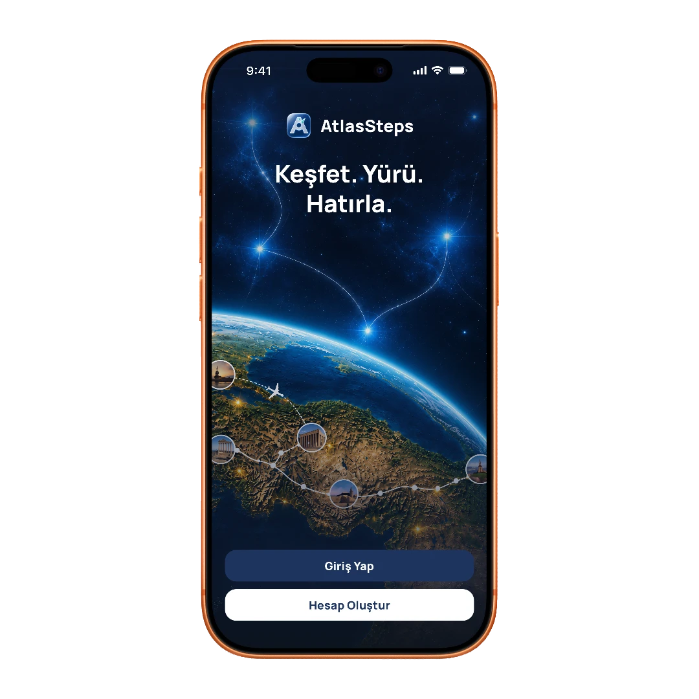
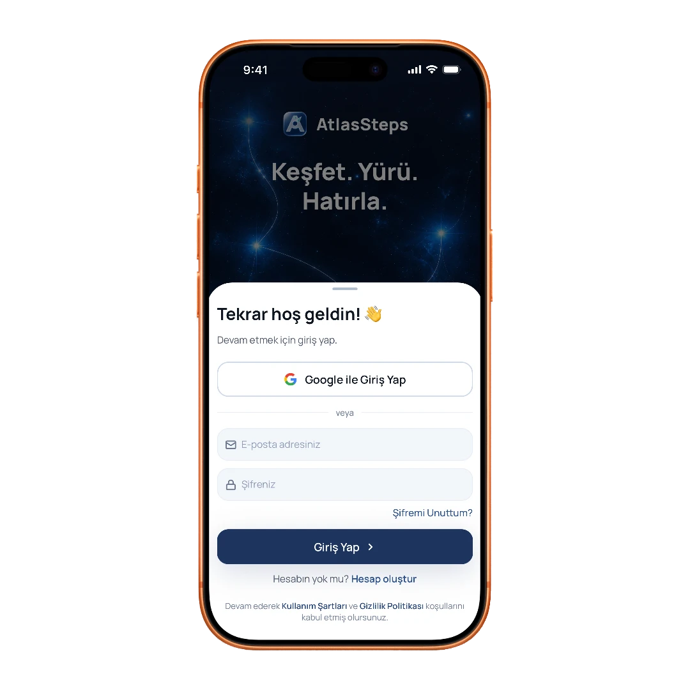
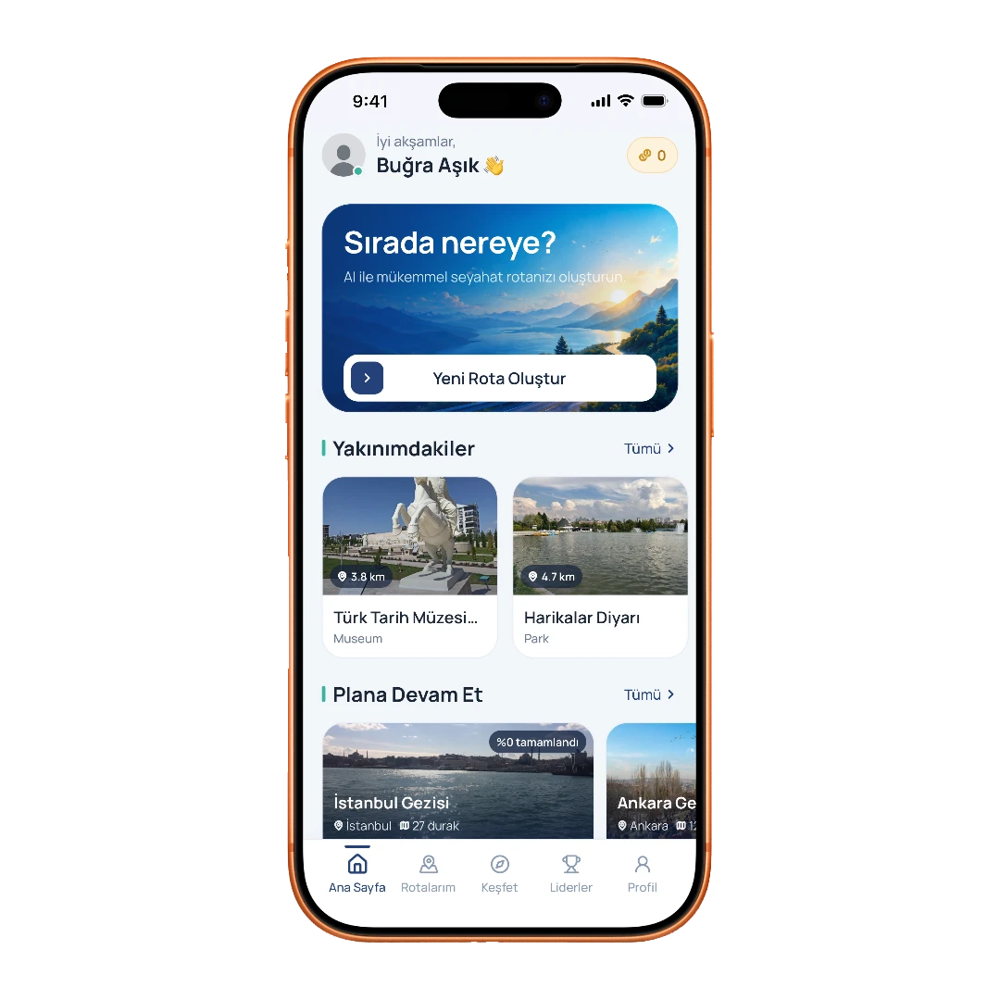
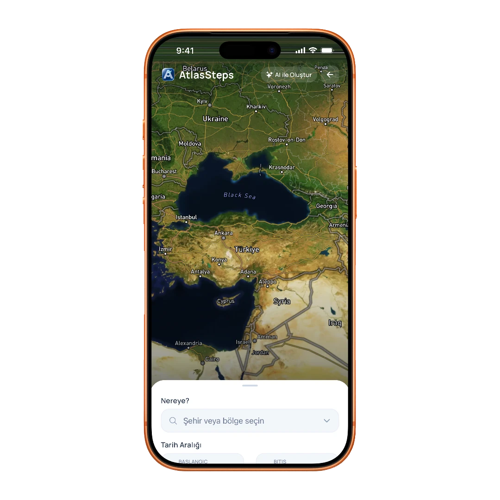
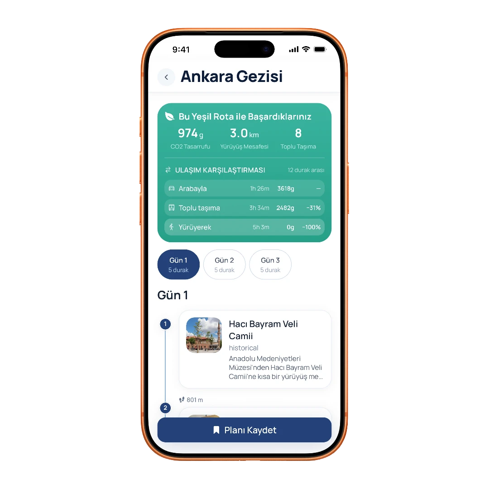
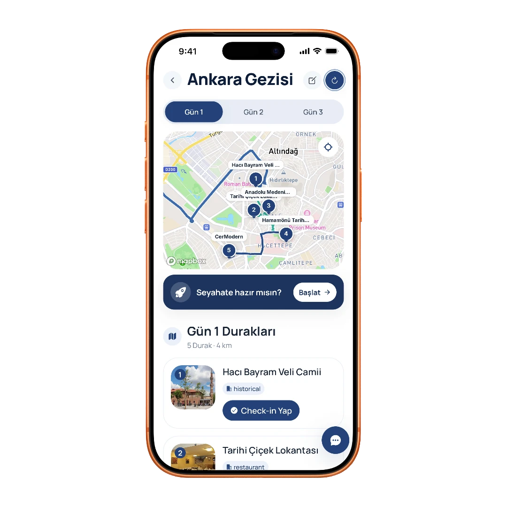

# 🌍 AtlasSteps - AI-Powered Smart Travel Assistant

Başkent Üniversitesi Bilgisayar Mühendisliği Bölümü **BİL494 Bitirme Projesi (2025-2026 Bahar)** kapsamında geliştirilen; yapay zekâ, oyunlaştırma ve sürdürülebilirlik odaklı dinamik bir mobil seyahat asistanıdır.

---

## 🚀 Proje Hakkında
Günümüz seyahat uygulamalarının statik yapısını aşmak için geliştirilen AtlasSteps; kullanıcının anlık enerji seviyesi, bütçesi ve tercihlerine göre rotaları dinamik olarak güncelleyen, çevre dostu ulaşımı (**Eko-Mod** ve $CO_2$ tasarrufu) teşvik eden bütünleşik bir mobil ekosistemdir.

* **Kapsam:** Türkiye genelindeki 81 ili kapsayan 2.500+ doğrulanmış İlgi Noktası (POI).
* **Sürdürülebilirlik:** BM Sürdürülebilir Kalkınma Hedefleri **SKH 11 (Sürdürülebilir Şehirler ve Topluluklar)** ile tam uyumlu.

---

## 🛠️ Kullanılan Teknolojiler (Tech Stack)
* **Mobil Ön Yüz:** React Native, Expo SDK, Mapbox Maps SDK
* **Arka Uç (Backend):** Python (FastAPI), RESTful API Mimarisi
* **Veritabanı & Coğrafi İşlemler:** PostgreSQL, PostGIS (Uzamsal Sorgular), SQLAlchemy, Alembic
* **Yapay Zeka & Servisler:** Google Gemini API (RAG-Lite, Akıllı Rota ve Asistan), Resend API, Google Directions/Places API

---

## 💡 Temel Özellikler & Benim Sorumluluklarım
* **Yapay Zeka Destekli Rota Üretimi & Optimizasyonu:** Google Gemini entegrasyonu ile kişiselleştirilmiş rotalar; **Gezgin Satıcı Problemi (TSP)** ve Haversine formülü kullanılarak zigzag çizmeyen en kısa yol optimizasyonu.
* **Konuşmalı Rota Oluşturma (`parse-intent`):** Form doldurmaya gerek kalmadan doğal dilde seyahat talebi oluşturabilme.
* **Dinamik Rota Revizyonu:** Seyahat esnasında anlık enerji ve bütçe durumuna göre planı saniyeler içinde güncelleyen akıllı mantık.
* **Oyunlaştırma & Check-in:** 100 metre GPS yarıçaplı geofencing doğrulaması, check-in sonrası şans çarkı puan çarpanı ve liderlik tablosu rekabeti.
* **Uygulama İçi Canlı Navigasyon:** Off-route tespiti ve otomatik yeniden hesaplama özellikli adım adım yönlendirme motoru.

---
## 📱 Uygulama Arayüzünden Kareler

  
  
  

  
  
  

